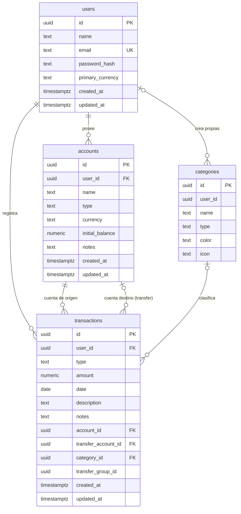

# DER — Modelo de datos (Atlass Fin, v0.3)

Diagrama entidad-relación del alcance vigente. Fuente de verdad: las entidades
TypeORM en `api/src/**/entities/*.entity.ts` (el esquema se deriva de ellas con
`synchronize`; no hay migraciones). Ver también `docs/architecture/backend.md` §5.

## Diagrama

## Tablas

### `users` — Usuario (FR-AUT-001/002)

| Columna | Tipo | Nulo | Notas |
| :--- | :--- | :--- | :--- |
| `id` | uuid | no | PK (`gen_random_uuid()`) |
| `name` | text | no | 2–80 |
| `email` | text | no | UNIQUE, `lowercase` |
| `password_hash` | text | no | argon2 (NFR-SEG-003) |
| `primary_currency` | text | no | moneda principal; default `ARS` |
| `created_at` | timestamptz | no | |
| `updated_at` | timestamptz | no | |

### `accounts` — Cuenta (FR-CUE-001/002/003/004)

| Columna | Tipo | Nulo | Notas |
| :--- | :--- | :--- | :--- |
| `id` | uuid | no | PK |
| `user_id` | uuid | no | FK → `users.id` `ON DELETE CASCADE` (indexado) |
| `name` | text | no | |
| `type` | text | no | `cash` \| `bank` \| `wallet` \| `other` |
| `currency` | text | no | ISO 4217; fija si la cuenta ya tiene movimientos (FR-CUE-001) |
| `initial_balance` | numeric(18,4) | no | |
| `notes` | text | sí | |
| `created_at` | timestamptz | no | |
| `updated_at` | timestamptz | no | |

> Saldo actual = `initial_balance` + Σ movimientos de la cuenta (calculado, FR-CUE-002), en la moneda de la cuenta.
> Eliminar la cuenta elimina en cascada los movimientos en los que participa, incluidas ambas patas de una transferencia (FR-CUE-003). La moneda no se puede cambiar si ya tiene movimientos (FR-CUE-001).

### `categories` — Categoría (sistema + propias)

| Columna | Tipo | Nulo | Notas |
| :--- | :--- | :--- | :--- |
| `id` | uuid | no | PK |
| `user_id` | uuid | sí | `NULL` = categoría del sistema (global), valor = propia del usuario |
| `name` | text | no | único por tipo, sin distinguir mayúsculas, entre sistema + propias |
| `type` | text | no | `income` \| `expense` (inmutable al editar) |
| `color` | text | no | hex |
| `icon` | text | sí | |

> Cinco categorías del sistema definidas por el seed y **no editables** (FR-CAT-001).
> Cada usuario puede crear, editar y eliminar las suyas. Al eliminar una propia,
> `transactions.category_id` pasa a `NULL` (`ON DELETE SET NULL`).

### `transactions` — Movimiento (FR-TRX-001, FR-TRX-004)

| Columna | Tipo | Nulo | Notas |
| :--- | :--- | :--- | :--- |
| `id` | uuid | no | PK |
| `user_id` | uuid | no | FK → `users.id` `ON DELETE CASCADE` (indexado) |
| `type` | text | no | `income` \| `expense` \| `transfer` |
| `amount` | numeric(18,4) | no | positivo en income/expense; con signo en transfer. En transferencia multimoneda cada fila lleva el monto en la moneda de su cuenta |
| `date` | date | no | `YYYY-MM-DD` |
| `description` | text | no | |
| `notes` | text | sí | |
| `account_id` | uuid | no | FK → `accounts.id` `ON DELETE CASCADE` (indexado) |
| `transfer_account_id` | uuid | sí | FK → `accounts.id` `ON DELETE CASCADE`; solo transferencias |
| `category_id` | uuid | sí | FK → `categories.id` `ON DELETE SET NULL` |
| `transfer_group_id` | uuid | sí | agrupa ambos lados de una transferencia (indexado) |
| `created_at` | timestamptz | no | |
| `updated_at` | timestamptz | no | |

## Reglas de integridad y cálculo

- **Propiedad (NFR-SEG-001):** `accounts` y `transactions` cuelgan de
  `users.id`; toda lectura/escritura filtra por el `user_id` autenticado.
  `categories` tiene las cinco globales (`user_id NULL`) más las propias de cada
  usuario.
- **Autenticación:** JWT stateless (access + refresh).
- **Transferencias (FR-TRX-001, CAL-003):** origen ≠ destino; se
  persisten **dos filas** (`type='transfer'`) con el mismo `transfer_group_id`,
  de forma atómica. En multimoneda cada fila guarda el monto en la moneda de su
  cuenta; la cotización usada en la UI no se persiste. Se excluyen de
  ingresos/gastos consolidados (CAL-003). Eliminar una de las cuentas
  involucradas elimina ambas patas (FR-CUE-003).
- **CAL-001 Patrimonio neto:** Σ (saldo × cotización) de las cuentas, en la moneda de lectura.
- **CAL-002 Flujo de fondos:** Σ ingresos − Σ gastos del período, convirtiendo cada flujo a la moneda de lectura.
- **Moneda:** multimoneda con cotizaciones globales provistas por la API; cada cuenta declara su moneda y el patrimonio se convierte a la moneda de lectura. Las cotizaciones **no se persisten**: se consultan a la API en cada lectura.
