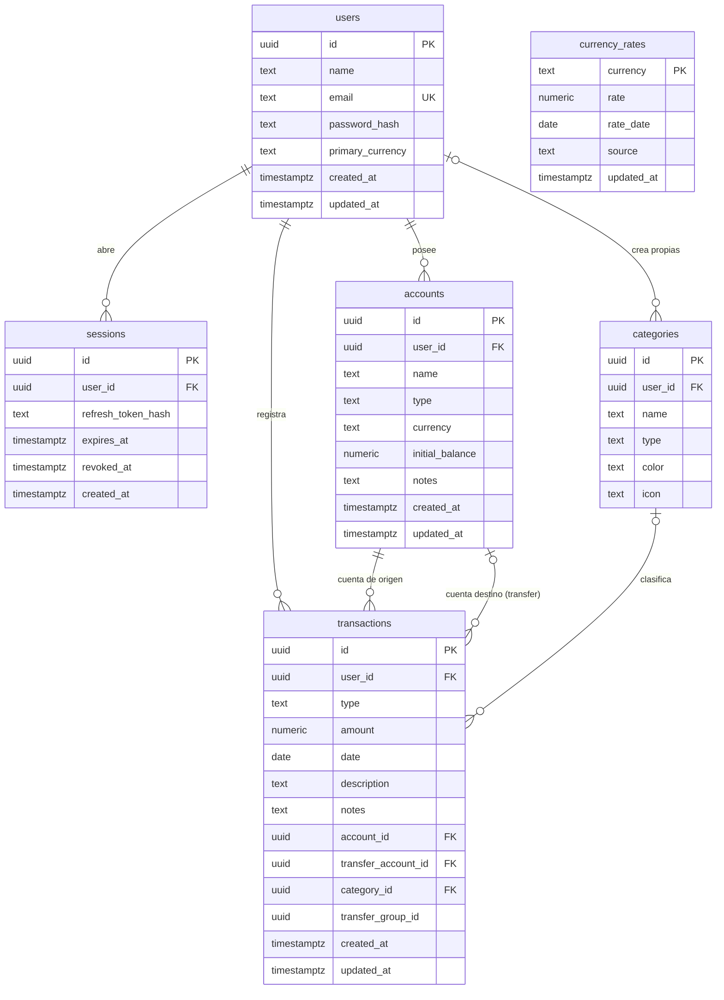

# DER — Modelo de datos (Atlass Fin, v0.3)

Diagrama entidad-relación del alcance vigente. Fuente de verdad: las entidades
TypeORM en `api/src/**/entities/*.entity.ts` (el esquema se deriva de ellas con
`synchronize`; no hay migraciones). Ver también `docs/architecture/backend.md` §5.

## Diagrama

> La relación de la transferencia consigo misma no es una FK: los dos lados de
> una transferencia se agrupan por `transfer_group_id` (mismo valor en ambas
> filas), dentro de una única transacción de base de datos (FR-TRX-005).

## Tablas

### `users` — Usuario (FR-AUT-001/002)

| Columna | Tipo | Nulo | Notas |
| :--- | :--- | :--- | :--- |
| `id` | uuid | no | PK (`gen_random_uuid()`) |
| `name` | text | no | 2–80 |
| `email` | text | no | UNIQUE, `lowercase` |
| `password_hash` | text | no | argon2 (NFR-SEG-003) |
| `primary_currency` | text | no | moneda principal; default `ARS` |
| `created_at` | timestamptz | no | |
| `updated_at` | timestamptz | no | |

### `sessions` — Sesión / refresh token

| Columna | Tipo | Nulo | Notas |
| :--- | :--- | :--- | :--- |
| `id` | uuid | no | PK |
| `user_id` | uuid | no | FK → `users.id` `ON DELETE CASCADE` (indexado) |
| `refresh_token_hash` | text | no | hash del refresh token opaco |
| `expires_at` | timestamptz | no | |
| `revoked_at` | timestamptz | sí | se marca al logout (FR-AUT-002) |
| `created_at` | timestamptz | no | |

### `accounts` — Cuenta (FR-CUE-001..005)

| Columna | Tipo | Nulo | Notas |
| :--- | :--- | :--- | :--- |
| `id` | uuid | no | PK |
| `user_id` | uuid | no | FK → `users.id` `ON DELETE CASCADE` (indexado) |
| `name` | text | no | |
| `type` | text | no | `cash` \| `bank` \| `wallet` \| `other` |
| `currency` | text | no | ISO 4217; fija si la cuenta ya tiene movimientos (RN-015) |
| `initial_balance` | numeric(18,4) | no | |
| `notes` | text | sí | |
| `created_at` | timestamptz | no | |
| `updated_at` | timestamptz | no | |

> Saldo actual = `initial_balance` + Σ movimientos de la cuenta (calculado, FR-CUE-004), en la moneda de la cuenta.
> Eliminar la cuenta elimina en cascada sus movimientos (FR-CUE-005). La moneda no se puede cambiar si ya tiene movimientos (RN-015).

### `categories` — Categoría (sistema + propias)

| Columna | Tipo | Nulo | Notas |
| :--- | :--- | :--- | :--- |
| `id` | uuid | no | PK |
| `user_id` | uuid | sí | FK → `users.id`; `NULL` = categoría del sistema (global), valor = propia del usuario |
| `name` | text | no | único por `(user_id, type)` (case-insensitive) |
| `type` | text | no | `income` \| `expense` (inmutable al editar) |
| `color` | text | no | hex |
| `icon` | text | sí | |

> Cinco categorías del sistema definidas por el seed y **no editables** (FR-TRX-002).
> Cada usuario puede crear, editar y eliminar las suyas. Al eliminar una propia,
> `transactions.category_id` pasa a `NULL` (`ON DELETE SET NULL`).

### `currency_rates` — Cotizaciones globales

| Columna | Tipo | Nulo | Notas |
| :--- | :--- | :--- | :--- |
| `currency` | text | no | PK; ISO 4217 |
| `rate` | numeric(18,6) | no | ARS por una unidad de la moneda |
| `rate_date` | date | no | fecha de la cotización de la API |
| `source` | text | no | `api` |
| `updated_at` | timestamptz | no | |

> Tabla **global**, no por usuario. El usuario no crea ni edita cotizaciones;
> el backend las refresca desde la API pública y conserva la última válida.
> Se usan para convertir el patrimonio y los flujos a la moneda de lectura.

### `transactions` — Movimiento (FR-TRX-001..005)

| Columna | Tipo | Nulo | Notas |
| :--- | :--- | :--- | :--- |
| `id` | uuid | no | PK |
| `user_id` | uuid | no | FK → `users.id` `ON DELETE CASCADE` (indexado) |
| `type` | text | no | `income` \| `expense` \| `transfer` |
| `amount` | numeric(18,4) | no | positivo en income/expense; con signo en transfer. En transferencia multimoneda cada fila lleva el monto en la moneda de su cuenta |
| `date` | date | no | `YYYY-MM-DD` |
| `description` | text | no | |
| `notes` | text | sí | |
| `account_id` | uuid | no | FK → `accounts.id` `ON DELETE CASCADE` (indexado) |
| `transfer_account_id` | uuid | sí | FK → `accounts.id` `ON DELETE SET NULL`; solo transferencias |
| `category_id` | uuid | sí | FK → `categories.id` `ON DELETE SET NULL` |
| `transfer_group_id` | uuid | sí | agrupa ambos lados de una transferencia (indexado) |
| `created_at` | timestamptz | no | |
| `updated_at` | timestamptz | no | |

## Reglas de integridad y cálculo

- **Propiedad (RN-001 / NFR-SEG-001):** `accounts`, `sessions` y `transactions`
  cuelgan de `users.id`; toda lectura/escritura filtra por el `user_id`
  autenticado. `categories` tiene las cinco globales (`user_id NULL`) más las
  propias de cada usuario.
- **Transferencias (FR-TRX-004/005, RN-003/004/017):** origen ≠ destino; se
  persisten **dos filas** (`type='transfer'`) con el mismo `transfer_group_id`,
  de forma atómica. En multimoneda cada fila guarda el monto en la moneda de su
  cuenta; la cotización usada en la UI no se persiste. Se excluyen de
  ingresos/gastos consolidados (CAL-003).
- **CAL-001 Patrimonio neto:** Σ (saldo × cotización) de las cuentas, en la moneda de lectura.
- **CAL-002 Flujo de fondos:** Σ ingresos − Σ gastos del período, convirtiendo cada flujo a la moneda de lectura.
- **Moneda:** multimoneda con cotizaciones globales provistas por la API; cada cuenta declara su moneda y el patrimonio se convierte a la moneda de lectura.

## Fuera de alcance (v0.3)

No existen tablas para: presupuestos, activos/valuaciones, deudas, posiciones,
objetivos, conversaciones de IA ni acciones del asistente. Las cotizaciones
viven en la tabla global `currency_rates` (no son datos del usuario). Ver
`docs/specification/0.3/FRD_Gestor_Financiero_v0.3.md` §1.
